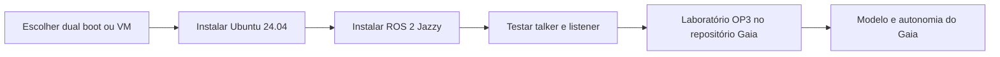

<h1>🐧 Gaia &#183; Ubuntu + ROS 2</h1>

<strong>Um caminho guiado para preparar o ambiente de rob&#243;tica da equipe.</strong>

<kbd>Ubuntu 24.04 LTS &#183; ROS 2 Jazzy</kbd>

 

<a href="#inicio-rapido">Comece aqui</a> · <a href="#guia-do-projeto">Documentação</a> · <a href="https://github.com/Pedronsjaja/gaia-ros2-ubuntu24/tree/main">Arquivos</a>

## 🚀 Comece aqui

**[Ver o roteiro de validação](docs/primeiros-passos.md)**

| Escolha do ambiente | Instalação guiada | Validação |
| --- | --- | --- |
| Comparação entre dual boot e máquina virtual. | Ubuntu e ROS 2 em etapas separadas. | Talker, listener e primeiros conceitos de ROS. |

### Caminho do projeto

## 📖 Documentação

Guia de preparação dos computadores da equipe Gaia. Ao terminar, você terá **Ubuntu Desktop 24.04 LTS + ROS 2 Jazzy**, com comunicação entre nós funcionando.

A instalação do simulador e o laboratório do OP3 ficam no [repositório de simulação do humanoide](https://github.com/Pedronsjaja/gaia-humanoid-simulation/tree/main/docs/simulacao). Este repositório cuida do ambiente Linux/ROS 2 que será comum à equipe.

**Primeira vez no GitHub?** Leia o [guia da equipe](https://github.com/Pedronsjaja/gaia-humanoid-simulation/blob/main/docs/primeiros-passos-github.md). Clique nos guias abaixo para ler; use **Code → Download ZIP** para baixar tudo. Execute comandos somente no terminal indicado.

## Caminho de aprendizagem

| Etapa | Guia | Resultado esperado |
| --- | --- | --- |
| 1A | [Ubuntu em dual boot com Windows](docs/dual-boot.md) | Escolher Ubuntu ou Windows ao ligar |
| 1B | [Ubuntu em máquina virtual](docs/maquina-virtual.md) | Ubuntu aberto dentro do Windows |
| 2 | [Instalar ROS 2 Jazzy](docs/ros2-jazzy.md) | Pacotes ROS disponíveis |
| 3 | [Verificar e entender o ambiente](docs/primeiros-passos.md) | Talker e listener trocando mensagens |
| Ajuda | [Problemas frequentes](docs/problemas.md) | Diagnosticar sistema, rede e gráficos |

Escolha **1A ou 1B**, depois siga 2 e 3. Os comandos Bash são executados **dentro do Ubuntu**, no Terminal (Ctrl+Alt+T), sem copiar o símbolo `$` de exemplos externos.

## Dual boot ou máquina virtual?

| Critério | Dual boot | Máquina virtual |
| --- | --- | --- |
| Uso do Windows | Precisa reiniciar para trocar | Windows e Ubuntu ao mesmo tempo |
| GPU e simulação | Acesso direto; opção preferida para cenas pesadas | Depende da aceleração gráfica virtual |
| Instalação | Altera particionamento/boot do computador | Cria disco virtual em um arquivo |
| USB de servos/câmeras | Acesso direto no Ubuntu | Requer entregar o dispositivo à VM |
| Uso sugerido pela equipe | Simulação física e integração | Primeiras aulas de ROS e testes leves |

Como ponto de partida **do laboratório**, sugerimos computador com 16 GB de RAM, SSD e 100 GB disponíveis; para VM, 8 GB de RAM, 4 vCPUs e disco virtual de 80 GB, deixando recursos para o Windows. Esses valores são orçamento de trabalho, não requisitos oficiais nem garantia de desempenho.

## Versões adotadas

| Camada | Versão |
| --- | --- |
| Sistema | Ubuntu Desktop **24.04 LTS**, codinome noble |
| ROS | **ROS 2 Jazzy Jalisco** |
| Simulação, instalada no guia Gaia | **Gazebo Harmonic** |
| Plataforma de referência | ROBOTIS OP3, fontes ROS 2 `jazzy-devel` |

Baixe a [série Ubuntu 24.04](https://releases.ubuntu.com/24.04/), mesmo que a página principal ofereça uma versão posterior. A combinação Jazzy/Noble está na [documentação ROS](https://docs.ros.org/en/jazzy/Installation/Ubuntu-Install-Debs.html), e Jazzy/Harmonic na [matriz Gazebo](https://gazebosim.org/docs/harmonic/ros_installation/).

Este roteiro usa PCs Intel/AMD x86-64. Equipamentos ARM exigem imagem e virtualizador compatíveis; não siga a escolha `amd64` em ARM.

## Critério para concluir

- Ubuntu informa `VERSION_ID="24.04"`.
- `echo "$ROS_DISTRO"` mostra `jazzy` após carregar o ambiente.
- O listener recebe mensagens do talker.
- A equipe consegue abrir RViz e explicar o que é um nó e um tópico.
- Cada pessoa registra sistema, hardware e resultado em [ficha de validação](docs/primeiros-passos.md).

Fontes consultadas em **20/09/2026**. Os comandos foram revisados contra documentação oficial; a instalação de dual boot/VM deve ser validada em cada computador. Não foi particionado nem reinstalado o computador do mantenedor durante a preparação deste guia.

## Repositórios da equipe Gaia

| Preciso de… | Repositório |
| --- | --- |
| Servo LX-225, BusLinker, drivers e testes de bancada | [LX-225 / BusLinker](https://github.com/Pedronsjaja/gaia-lx225-buslinker) |
| Gazebo, OP3, ROS 2 e autonomia | [Simulação](https://github.com/Pedronsjaja/gaia-humanoid-simulation) |
| CAD, suportes, montagem e requisitos físicos da CBR | [Estrutura](https://github.com/Pedronsjaja/gaia-humanoid-structure) |
| Instalar Ubuntu 24.04 e ROS 2 Jazzy | [Ambiente Linux / ROS 2](https://github.com/Pedronsjaja/gaia-ros2-ubuntu24) |

Cada repositório tem seus próprios arquivos, Issues e histórico. Abra dúvidas na área correspondente; inclua links quando uma mudança depender de outra área.

## Engenharia e validacao

[Estado tecnico, validacao e proximos passos](docs/engineering-status.md).
